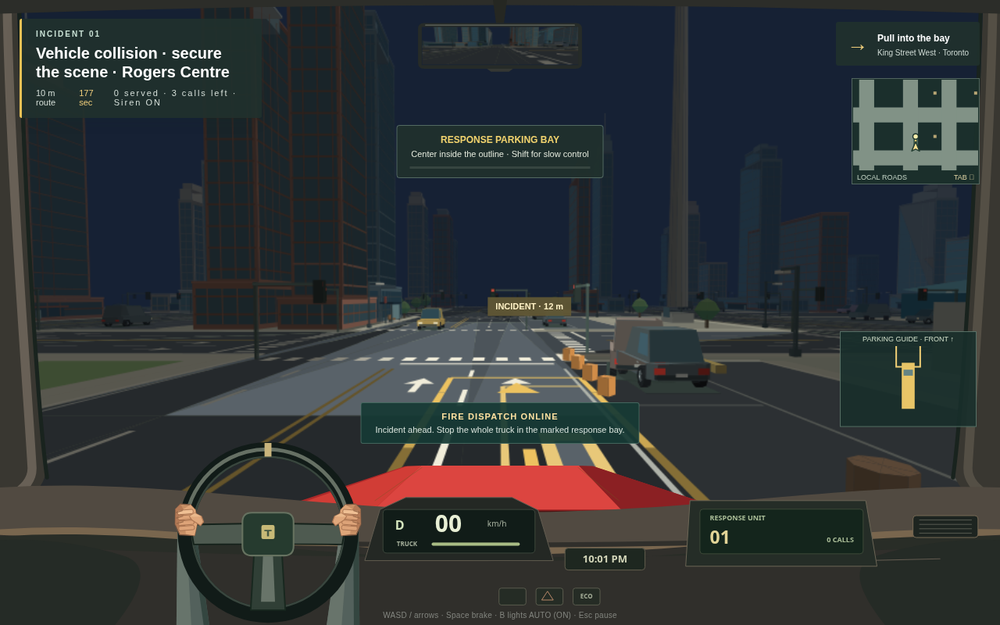
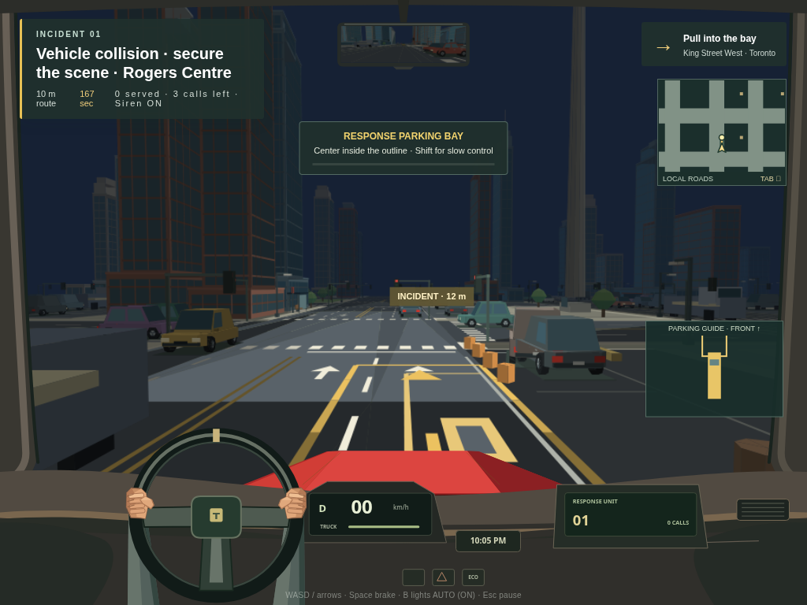

# Time, night lighting and functional headlights

Title-screen time remains keyboard-accessible in 12-hour format. The selected time and headlight mode persist on reload. The simulation clock drives daylight, twilight and night, and pause freezes it.

B cycles AUTO / ON / OFF. AUTO enables headlights in twilight/night. The world-space beam lights the road and nearby vehicles in front of the truck, including when the driver looks elsewhere. Range, beam direction and vertical separation are bounded. Night retains 42% ambient illumination for readable gameplay. Sky and distance fog follow the same time model. The cab/HUD remain readable.

WebGL uses inexpensive per-vertex lighting; Canvas uses visible-face lighting and quantized cached palettes. Neither adds shadow maps, bloom, extra scene passes or additional traffic. Night headlights have no effect on physics, siren priority or dispatch timing.

Validation: lighting-check.cjs tests day/dusk/night, road/vehicle illumination, direction/range/height exclusions, upper-road placement and overrides. lighting-browser.cjs uses actual keyboard time selection, drives/brakes, inspects day/dusk/night in both Canvas and WebGL, verifies pause/reload/menu behavior and compares rendered pixels with lamps on/off. The vehicle pixel sample uses an explicitly placed parked-vehicle fixture while paused. Both road and vehicle samples brighten with headlights; details are in lighting-browser.json. Screenshots were inspected. Long-truck bounds, first-call parking/restart, low-power menu scheduling, corner-promotion refusal, safe recovery and 160 km/h checks pass.

Performance records are reconciled in PERFORMANCE.md. No physical weak-computer certification or shadow/occlusion simulation is claimed. Fires/cannon are a later, separate release.

